<div align="center">
  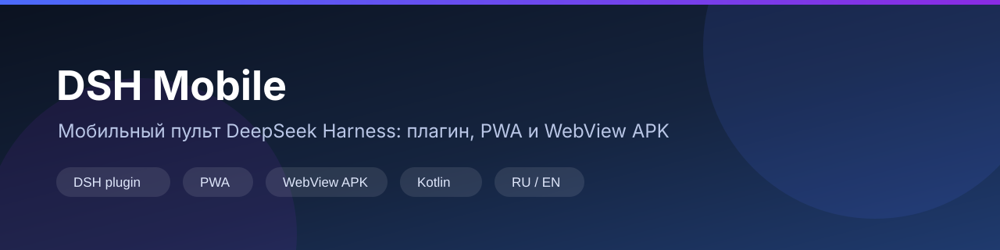
</div>

# DSH Mobile — пульт управления DeepSeek Harness с телефона

**RU** · [English](#english)

<p align="center">
  <a href="https://github.com/rukazax"></a>
  <a href="#ограничения-v1-честно"></a>
  <a href="#ограничения-v1-честно"></a>
  <a href="LICENSE"></a>
</p>

> Мобильный клиент для **DeepSeek Harness** (DSH): управление живыми сессиями агента
> с Android-телефона или раскладного устройства (Honor Magic V3 и аналоги),
> синхронизация истории **без единого лишнего токена** и без пересылки транскрипта.

> Это отдельный проект в рабочей папке DSH. Он не меняет shipped-код DeepSeek
> Harness: клиент ставится как плагин в профиль и работает поверх штатных сервисов
> хоста (сессии, журнал событий, approvals).

**GitHub:** [github.com/rukazax/dsh-mobile](https://github.com/rukazax/dsh-mobile) ·
**APK:** [последний релиз](https://github.com/rukazax/dsh-mobile/releases) ·
**PDF-инструкция:** [19 страниц](docs/guide/DSH-Mobile-Инструкция.pdf)

## 🧭 Навигация

| Раздел | О чём |
|---|---|
| [Что уже работает](#что-уже-работает) | Статус-таблица возможностей и проверок |
| [Архитектура в двух словах](#архитектура-в-двух-словах) | Плагин внутри DSH, LAN-listener, SSE |
| [Быстрый старт](#быстрый-старт) | Установка плагина, pairing, APK |
| [Почему «без лишних затрат токенов»](#почему-без-лишних-затрат-токенов) | Таблица стоимости операций |
| [Раскладные устройства](#раскладные-устройства) | Viewport Segments, Honor Magic V3 |
| [Безопасность](#безопасность) | Bearer-токен, pairing, TLS |
| [Скриншоты и схемы](#скриншоты-и-схемы) | Интерфейс и диаграммы работы |
| [Структура репозитория](#структура-репозитория) | Каталоги и их назначение |
| [Документация](#документация) | PDF-инструкция, архитектура, протокол |
| [Ограничения v1 (честно)](#ограничения-v1-честно) | Что проверено, а что нет |
| [Лицензия](#лицензия) | MIT |
| [English](#english) | Полная английская версия |

## Что уже работает

| Возможность | Статус |
|---|---|
| Pairing по одноразовому коду (страница `/m/pair` на ПК, QR-ссылка `dshm://pair`, ручной ввод) | ✅ проверено на реальном DSH |
| Список сессий с заголовками, статусом `running/blocked`, моделью, воркспейсом | ✅ проверено, реальные сессии |
| Открытие сессии: последние ~35 событий (последний ход + промпт пользователя), 4–6 КБ gzip | ✅ проверено |
| Живой поток SSE: durable-дельты по курсору, `live`-чанки ассистента, `state`, `approval`, `resync` | ✅ проверено |
| Отправка промпта (transcript / queue / steer), идемпотентность по `requestId` | ✅ маршрут и валидация проверены; реальный промпт не отправлялся (экономия токенов) |
| Остановка хода, очистка очереди, отзыв устройства, rate-limit | ✅ |
| Approvals: наблюдение + ответ с телефона, когда десктопный GUI не подключён | ⚠️ реализовано, вживую не проверено (нужен реальный tool-approval) |
| Вопросы `ask_user` | ⚠️ только наблюдение; ответ — на десктопе (v1) |
| PWA: офлайн-кэш, IndexedDB, установка на домашний экран | ✅ код и статика проверены; визуально в браузере не проверялось (нет браузера в песочнице) |
| Раскладные: двухпанельный режим по viewport segments, hinge-gutter, Layout Lab | ✅ CSS/логика проверены, визуально — на устройстве |
| APK-обёртка (WebView) + CI-сборка | ✅ APK собран локально (debug 2.25 МБ, release 1.74 МБ); runtime на устройстве — не проверен |

Подробный отчёт о проверках — [docs/verification.md](docs/verification.md).

## Архитектура в двух словах

```
Телефон (PWA или APK-WebView)
   │  Wi-Fi, Bearer device-token
   ▼
Плагин dsh-mobile внутри процесса DSH ──► LAN-listener :3081 (PWA + /api/v1 + SSE)
   │                                   └─► /m/pair на родном loopback- origin (cookie DSH)
   ├─ ctx.sessionController / sessionQuery  (чтение истории, cold-safe)
   ├─ корневая шина session/event            (живые дельты)
   ├─ ctx.agent-loop / assistant-stream      (живой текст)
   ├─ ctx.approval (waterfall)               (релей approvals)
   └─ ctx.workspaceRegistry / ctx.jobs       (воркспейсы, фоновые задачи)
```

- PWA и шлюз отдаются **одним origin** (`:3081`), поэтому нет CORS-плясок и
  cookie-конфликтов; pairing-код никогда не показывается в LAN — только на
  loopback-странице `/m/pair`.
- Чтение — только durable-события уже существующего журнала сессии. Никаких
  вызовов модели, заголовков, компакции или «прогрева» холодной сессии при
  просмотре. Открытие сессии с телефона = **0 токенов**.
- Ответы на approvals по умолчанию остаются за десктопным GUI; телефон
  перехватывает их только если десктопная вкладка не подключена (настраивается).

## Быстрый старт

### 1. Установить плагин в профиль DSH

Плагин — локальный пакет `packages/dsh-mobile`. Установка (Windows, из этой папки):

```powershell
# 1) полностью закройте DeepSeek Harness
# 2) поставьте плагин в профиль desktop
& "C:\Users\<вы>\AppData\Local\Programs\DeepSeek Harness\resources\runtime\cli\bin\dsh.cmd" `
    plugin --profile desktop add "link:C:\Users\<user>\Documents\deepseek-harness\harness\packages\dsh-mobile"
# 3) запустите DeepSeek Harness
```

Точные пути и альтернативы (страница Plugins в приложении, `dsh plugin add link:…`
для тестового профиля) — в [docs/install.md](docs/install.md).

### 2. Спарить телефон

1. На ПК откройте **`http://127.0.0.1:<порт DSH>/m/pair`** (можно из окна DSH).
   Там: код из 8 символов, LAN-адреса, список устройств.
2. На телефоне: `http://<LAN-IP>:3081/` → «Подключить ПК» → адрес и код
   (или откройте `dshm://pair?url=http://192.168.1.10:3081&code=XXXXXXXX` из QR).
3. Готово: список сессий, чат, отправка, остановка, approvals.

### 3. APK

Исходники Android-обёртки — `android/`, CI-workflow — `.github/workflows/android.yml`.
Локальный тулчейн установлен (JDK 17, Android SDK 35, Gradle 8.9), APK собран:

```
android/app/build/outputs/apk/debug/app-debug.apk              2.25 МБ  (устанавливаемый)
android/app/build/outputs/apk/release/app-release-unsigned.apk 1.74 МБ (без подписи)
```

Сборка: `. .\android\env.ps1; cd android; .\gradlew.bat assembleDebug`. Подробно —
[android/README.md](android/README.md). PWA при этом полноценно работает и из браузера
(на HTTP — как ярлык; для standalone + service worker нужен HTTPS или APK).

## Почему «без лишних затрат токенов»

| Что делает клиент | Стоимость |
|---|---|
| список сессий | 0 токенов (кэш заголовков/метаданных) |
| открытие сессии | 0 токенов (durable-журнал, cold-safe чтение) |
| живой поток | 0 токенов (шина событий), байты только на дельты |
| реконнект | 0 токенов (курсор `seq`, докачка пропущенного) |
| смена posture/ориентации | 0 токенов (CSS-only, поток не пересоздаётся) |
| промпт с телефона | ровно как с десктопа, без накладных вызовов |

Запрещено архитектурой: вызов `sessionTitle.refresh()` (LLM), компакция при
чтении, `session/follow` для холодных сессий (он «промоутит» агента и пишет
служебные события), периодический polling, пересылка полного транскрипта.
Бюджет: список ≤ 25 КБ gzip, открытие сессии ≤ 15 КБ gzip, дельта хода ≤ 8 КБ.
Факт: открытие реальной сессии — 4.3 КБ gzip / 35 событий (см. verification.md).

## Раскладные устройства

Honor Magic V3: 2344×2156 (внутренний, два сегмента) и 1060×2376 (внешний).
Клиент использует CSS Viewport Segments:

- `@media (horizontal-viewport-segments: 2)` и `(spanning: single-fold-vertical)`;
- ширины панелей через `env(viewport-segment-width …)`, шов — реальный gutter
  (`max(16px, left(seg1) − right(seg0))`), контент не пересекает сгиб;
- открыт → две панели (список + чат), сложен → одна панель с навигацией,
  планшет ≥840dp → постоянный rail;
- смена posture — **только CSS**, состояние (черновик, скролл, SSE, открытая
  сессия) не сбрасывается;
- Layout Lab: `?demo=1&lab=1` — симулятор сегментов на обычном экране.

Подробно — [docs/ux-notes.md](docs/ux-notes.md).

## Безопасность

- LAN-порт `:3081` — отдельный сокет плагина, вне DSH trust-fence. Авторизация —
  собственный Bearer-токен устройства (32 байта, в файле лежит только SHA-256).
- Pairing-код одноразовый, 8 символов, TTL 5 минут, 5 попыток, rate-limit по IP.
- Код показывается только на `127.0.0.1`-странице `/m/pair`, защищённой cookie DSH.
- HTTP по LAN = токен виден в трафике. Для домашней сети допустимо; для чего-то
  большего — TLS (`tls.certFile/tls.keyFile` в конфиге) или доверенный туннель.
- Отзыв устройства: `/m/pair` → «Отозвать» (или `POST /api/v1/devices/revoke`).
- Плагин не имеет доступа к секретам DSH и не пишет в журнал сессий.

## Скриншоты и схемы

Интерфейс (реальные снимки PWA, демо-данные; светлая и тёмная темы):

| Список сессий | Чат и инструменты | Подтверждение |
|---|---|---|
| 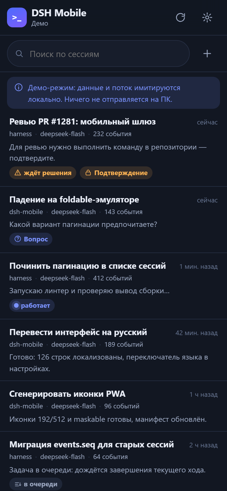 | 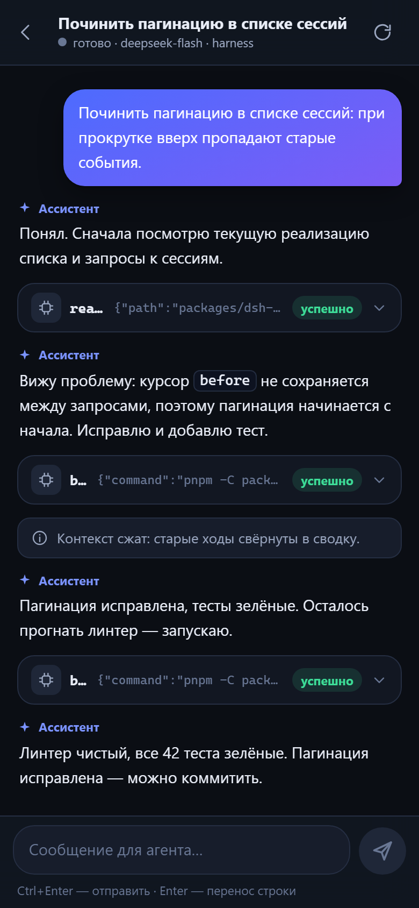 | 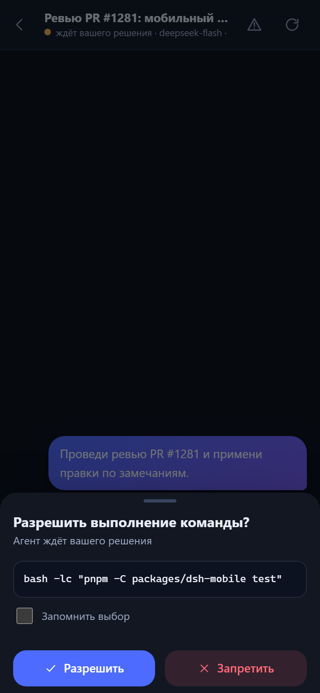 |
| 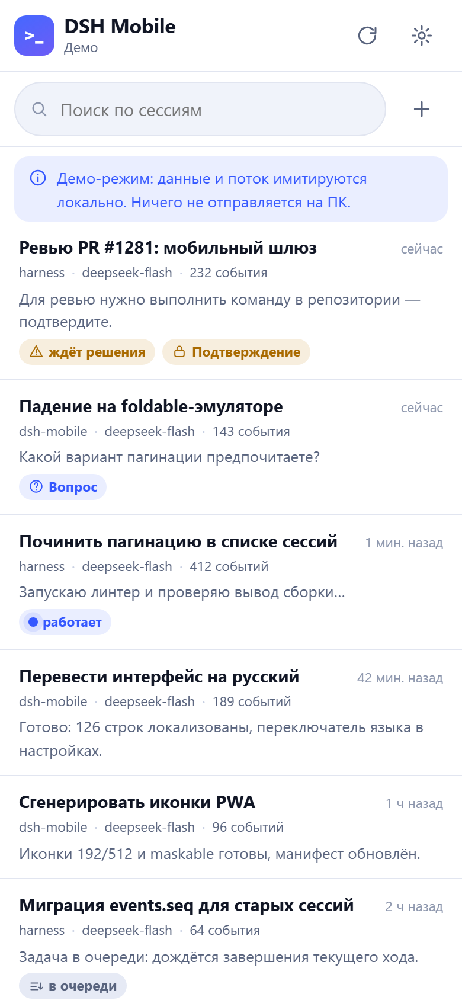 | 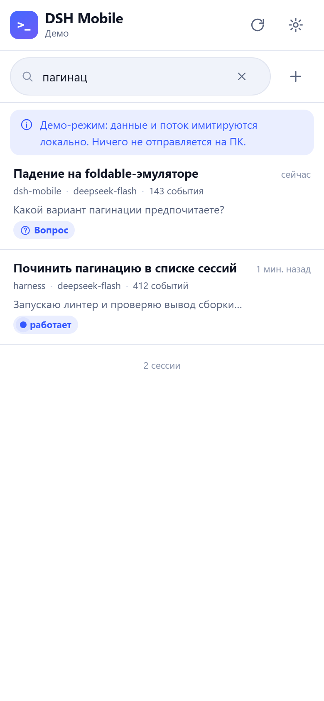 | 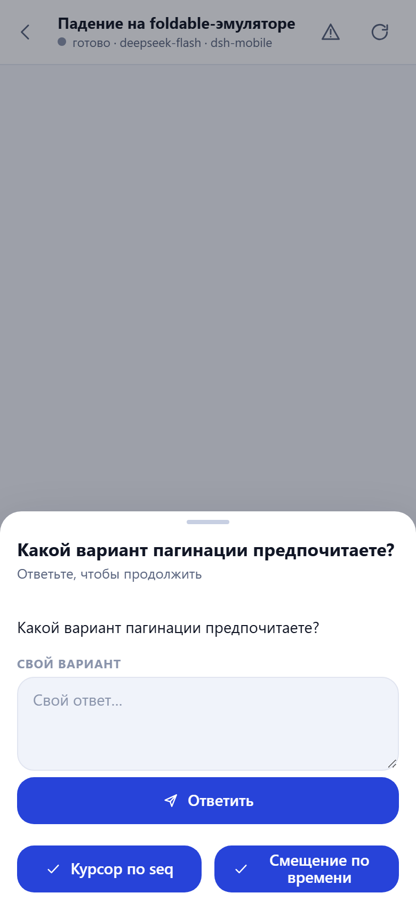 |

Страница привязки на компьютере и раскладной экран:

| Привязка на ПК | Две панели (раскладной/планшет) |
|---|---|
| 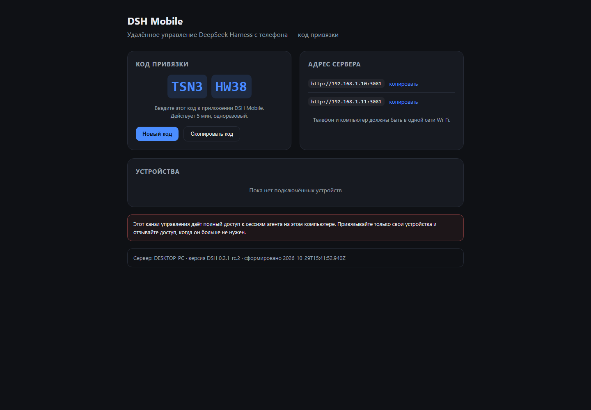 | 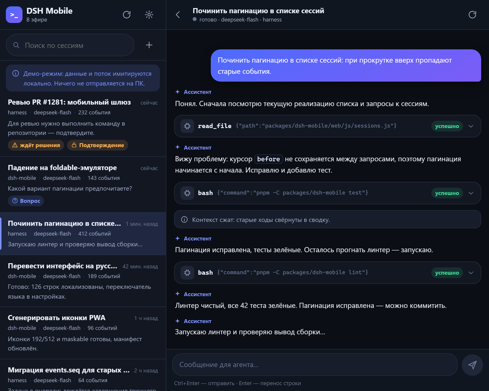 |

Схемы работы:

| Слои установки | Как проходит промпт |
|---|---|
| 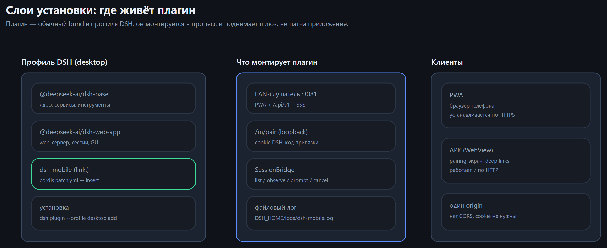 | 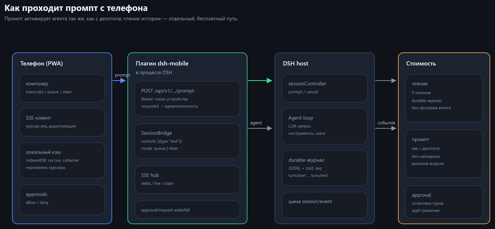 |

| Журнал и события | Границы доверия |
|---|---|
| 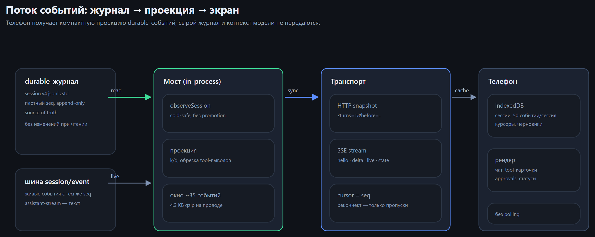 | 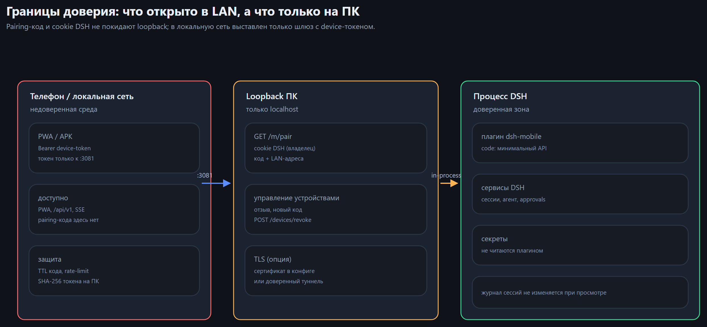 |

| Архитектура | Синхронизация | Approvals |
|---|---|---|
| 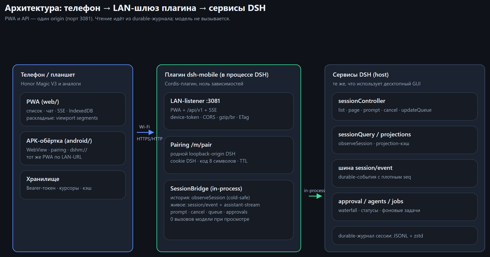 | 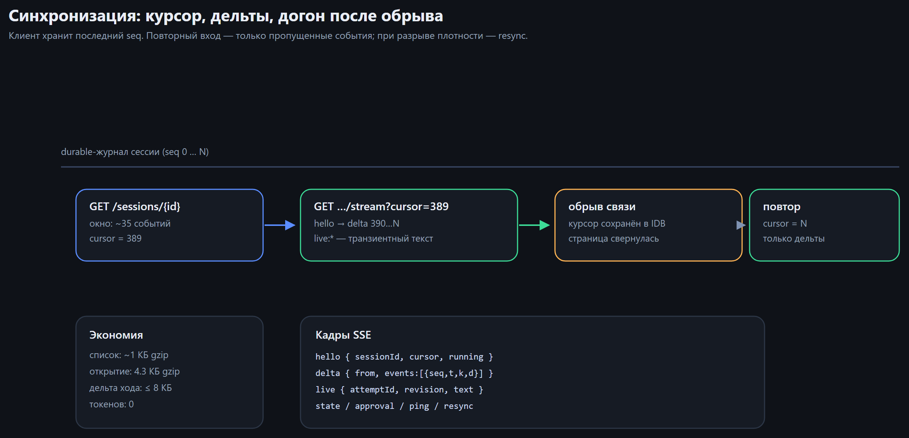 | 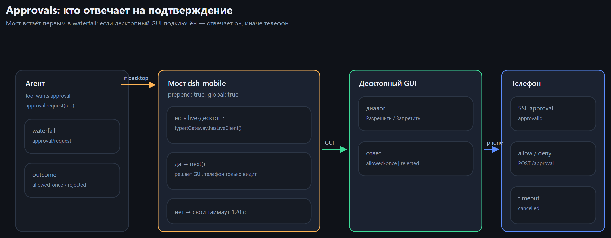 |

Больше иллюстраций — в [PDF-инструкции](docs/guide/DSH-Mobile-Инструкция.pdf) (19 страниц) и [галерее](docs/guide/README.md).

## Структура репозитория

```
packages/dsh-mobile/        плагин + PWA
  lib/index.js              Cordis-вход: LAN-listener, /m/pair, лог-файл
  src/                      конфиг, auth, store, http/static/SSE, routes, session-bridge
  web/                      PWA (vanilla ES modules, без сборки)
  test/                     20 unit/e2e-тестов (node:test, in-process runner)
android/                    Android WebView-обёртка + sync-web.ps1
.github/workflows/android.yml  CI-сборка APK
docs/                       архитектура, установка, протокол, проверки, UX
research/                   исследование API DSH, извлечённый app.asar, тестовый профиль
```

## Документация

- 📄 **[Инструкция с иллюстрациями (PDF, 19 страниц)](docs/guide/DSH-Mobile-Инструкция.pdf)** —
  пошаговое руководство со скриншотами интерфейса и схемами; исходники и скрипты — [docs/guide/](docs/guide/README.md).
- [docs/architecture.md](docs/architecture.md) — архитектура, решения, альтернативы, угрозы.
- [docs/install.md](docs/install.md) — установка, конфиг, обновление, диагностика.
- [docs/mobile-api.md](docs/mobile-api.md) — протокол `/api/v1` (HTTP + SSE).
- [docs/verification.md](docs/verification.md) — как и что проверялось (реальные выводы).
- [docs/ux-notes.md](docs/ux-notes.md) — UX/раскладные/синхронизация.
- [docs/android.md](docs/android.md) — APK/PWA, сборка, ограничения.
- [docs/android-toolchain.md](docs/android-toolchain.md) — установленный локальный тулчейн (JDK 17, SDK 35, Gradle 8.9), сборка и результаты.
- [packages/dsh-mobile/README.md](packages/dsh-mobile/README.md) — пакет плагина.

## Ограничения v1 (честно)

1. **APK собран, но не запускался** локально (нет подключённого устройства/эмулятора);
   сборка Gradle/wrapper проходит, APK проверен `aapt2`.
2. **PWA проверена снимками headless Chromium** (светлая/тёмная темы, раскладной режим);
   интерактивное поведение на физическом телефоне — на устройстве.
3. **Approvals/вопросы вживую не проверены**: нет тестового tool-approval без
   вызова модели; механика waterfall реализована по документации и коду DSH.
4. **Промпты не отправлялись** намеренно (не тратим токены); проверены маршрут,
   валидация, идемпотентность.
5. **Вложения/картинки** не поддерживаются в v1 (`attachments:false`).
6. **Вопросы `ask_user`** — только отображение; ответ на десктопе.
7. HTTP по LAN без TLS — осознанный компромисс для домашней сети.

## Лицензия

MIT (см. `packages/dsh-mobile/package.json`). Проект не является официальным
продуктом DeepSeek; использует публичные API DeepSeek Harness.

---

## English

**DSH Mobile** — a remote control for DeepSeek Harness from your phone.

A mobile client for **DeepSeek Harness** (DSH): manage live agent sessions from an
Android phone or a foldable device (Honor Magic V3 and similar), syncing history
**without a single extra token** and without forwarding the transcript.

> This is a separate project inside the DSH workspace. It does not change shipped
> DeepSeek Harness code: the client installs as a plugin into a profile and works on
> top of the host's standard services (sessions, event log, approvals).

**GitHub:** [github.com/rukazax/dsh-mobile](https://github.com/rukazax/dsh-mobile) ·
**APK:** [latest release](https://github.com/rukazax/dsh-mobile/releases) ·
**PDF manual:** [19 pages](docs/guide/DSH-Mobile-Инструкция.pdf)

### What already works

| Feature | Status |
|---|---|
| Pairing via a one-time code (the `/m/pair` page on the PC, a `dshm://pair` QR link, manual entry) | ✅ verified on a real DSH |
| Session list with titles, `running/blocked` status, model, workspace | ✅ verified, real sessions |
| Opening a session: last ~35 events (latest run + the user prompt), 4–6 KB gzip | ✅ verified |
| Live SSE stream: durable deltas by cursor, `live` assistant chunks, `state`, `approval`, `resync` | ✅ verified |
| Sending a prompt (transcript / queue / steer), idempotency by `requestId` | ✅ route and validation verified; no real prompt was sent (saving tokens) |
| Stopping a run, clearing the queue, revoking a device, rate-limit | ✅ |
| Approvals: watching + answering from the phone when the desktop GUI isn't connected | ⚠️ implemented, not verified live (needs a real tool-approval) |
| `ask_user` questions | ⚠️ display only; answering stays on the desktop (v1) |
| PWA: offline cache, IndexedDB, install to the home screen | ✅ code and statics verified; not visually checked in a browser (no browser in the sandbox) |
| Foldables: two-pane mode by viewport segments, hinge-gutter, Layout Lab | ✅ CSS/logic verified, visually — on the device |
| APK wrapper (WebView) + CI build | ✅ APK built locally (debug 2.25 MB, release 1.74 MB); on-device runtime — not verified |

A detailed verification report — [docs/verification.md](docs/verification.md).

### Architecture in a nutshell

```
Phone (PWA or APK WebView)
   │  Wi-Fi, Bearer device-token
   ▼
dsh-mobile plugin inside the DSH process ──► LAN-listener :3081 (PWA + /api/v1 + SSE)
   │                                        └─► /m/pair on the native loopback origin (DSH cookie)
   ├─ ctx.sessionController / sessionQuery  (history reads, cold-safe)
   ├─ the root session/event bus            (live deltas)
   ├─ ctx.agent-loop / assistant-stream     (live text)
   ├─ ctx.approval (waterfall)              (approval relay)
   └─ ctx.workspaceRegistry / ctx.jobs      (workspaces, background jobs)
```

- The PWA and the gateway are served from **one origin** (`:3081`), so there are no
  CORS dances or cookie conflicts; the pairing code is never shown on the LAN —
  only on the loopback `/m/pair` page.
- Reads use only the durable events of an already existing session log. No model
  calls, titles, compaction or «warming up» a cold session while browsing.
  Opening a session from the phone = **0 tokens**.
- Approval answers stay with the desktop GUI by default; the phone intercepts them
  only if the desktop tab isn't connected (configurable).

### Quick start

#### 1. Install the plugin into the DSH profile

The plugin is the local package `packages/dsh-mobile`. Installation (Windows, from this folder):

```powershell
# 1) fully close DeepSeek Harness
# 2) install the plugin into the desktop profile
& "C:\Users\<you>\AppData\Local\Programs\DeepSeek Harness\resources\runtime\cli\bin\dsh.cmd" `
    plugin --profile desktop add "link:C:\Users\<user>\Documents\deepseek-harness\harness\packages\dsh-mobile"
# 3) start DeepSeek Harness
```

Exact paths and alternatives (the Plugins page in the app, `dsh plugin add link:…`
for a test profile) — in [docs/install.md](docs/install.md).

#### 2. Pair the phone

1. On the PC open **`http://127.0.0.1:<DSH port>/m/pair`** (you can do it from the DSH window).
   There: an 8-character code, LAN addresses, the device list.
2. On the phone: `http://<LAN-IP>:3081/` → «Connect PC» → the address and the code
   (or open `dshm://pair?url=http://192.168.1.10:3081&code=XXXXXXXX` from the QR).
3. Done: session list, chat, sending, stopping, approvals.

#### 3. APK

The Android wrapper sources are `android/`, the CI workflow is `.github/workflows/android.yml`.
The local toolchain is installed (JDK 17, Android SDK 35, Gradle 8.9), the APK is built:

```
android/app/build/outputs/apk/debug/app-debug.apk              2.25 MB  (installable)
android/app/build/outputs/apk/release/app-release-unsigned.apk 1.74 MB (unsigned)
```

Build: `. .\android\env.ps1; cd android; .\gradlew.bat assembleDebug`. Details —
[android/README.md](android/README.md). The PWA also works fully from a browser
(over HTTP — as a shortcut; standalone + service worker needs HTTPS or the APK).

### Why «no extra token cost»

| What the client does | Cost |
|---|---|
| session list | 0 tokens (header/metadata cache) |
| opening a session | 0 tokens (durable log, cold-safe read) |
| live stream | 0 tokens (event bus), bytes only for deltas |
| reconnect | 0 tokens (the `seq` cursor, missed data is backfilled) |
| posture/orientation change | 0 tokens (CSS only, the stream isn't recreated) |
| a prompt from the phone | exactly like on the desktop, no extra calls |

Forbidden by architecture: calling `sessionTitle.refresh()` (LLM), compaction while
reading, `session/follow` for cold sessions (it «promotes» the agent and writes
service events), periodic polling, forwarding the full transcript.
Budget: list ≤ 25 KB gzip, session open ≤ 15 KB gzip, run delta ≤ 8 KB.
Fact: opening a real session — 4.3 KB gzip / 35 events (see verification.md).

### Foldables

Honor Magic V3: 2344×2156 (inner, two segments) and 1060×2376 (outer).
The client uses CSS Viewport Segments:

- `@media (horizontal-viewport-segments: 2)` and `(spanning: single-fold-vertical)`;
- pane widths via `env(viewport-segment-width …)`, the seam is the real gutter
  (`max(16px, left(seg1) − right(seg0))`), content never crosses the fold;
- open → two panes (list + chat), folded → one pane with navigation,
  tablet ≥840dp → a permanent rail;
- a posture change — **CSS only**, state (draft, scroll, SSE, the open session)
  isn't reset;
- Layout Lab: `?demo=1&lab=1` — a segment simulator on an ordinary screen.

Details — [docs/ux-notes.md](docs/ux-notes.md).

### Security

- The LAN port `:3081` is the plugin's own socket, outside the DSH trust-fence.
  Auth is a per-device Bearer token (32 bytes; only the SHA-256 is stored on disk).
- The pairing code is one-time, 8 characters, TTL 5 minutes, 5 attempts, per-IP rate-limit.
- The code is shown only on the `127.0.0.1` `/m/pair` page protected by the DSH cookie.
- HTTP over LAN = the token is visible in traffic. Acceptable for a home network;
  for anything more — TLS (`tls.certFile/tls.keyFile` in the config) or a trusted tunnel.
- Device revocation: `/m/pair` → «Revoke» (or `POST /api/v1/devices/revoke`).
- The plugin has no access to DSH secrets and doesn't write to session logs.

### Screenshots and diagrams

Real interface screenshots and work diagrams — in the Russian part above (the same
images), in the [PDF manual](docs/guide/DSH-Mobile-Инструкция.pdf) (19 pages) and in the
[gallery](docs/guide/README.md).

### Repository structure

```
packages/dsh-mobile/        plugin + PWA
  lib/index.js              Cordis entry: LAN-listener, /m/pair, log file
  src/                      config, auth, store, http/static/SSE, routes, session-bridge
  web/                      PWA (vanilla ES modules, no build step)
  test/                     20 unit/e2e tests (node:test, in-process runner)
android/                    Android WebView wrapper + sync-web.ps1
.github/workflows/android.yml  CI APK build
docs/                       architecture, install, protocol, verification, UX
research/                   DSH API research, the extracted app.asar, a test profile
```

### Documentation

- 📄 **[Illustrated manual (PDF, 19 pages)](docs/guide/DSH-Mobile-Инструкция.pdf)** —
  a step-by-step guide with UI screenshots and diagrams; sources and scripts — [docs/guide/](docs/guide/README.md).
- [docs/architecture.md](docs/architecture.md) — architecture, decisions, alternatives, threats.
- [docs/install.md](docs/install.md) — installation, config, update, diagnostics.
- [docs/mobile-api.md](docs/mobile-api.md) — the `/api/v1` protocol (HTTP + SSE).
- [docs/verification.md](docs/verification.md) — what was checked and how (real outputs).
- [docs/ux-notes.md](docs/ux-notes.md) — UX/foldables/sync.
- [docs/android.md](docs/android.md) — APK/PWA, build, limitations.
- [docs/android-toolchain.md](docs/android-toolchain.md) — the installed local toolchain (JDK 17, SDK 35, Gradle 8.9), build and results.
- [packages/dsh-mobile/README.md](packages/dsh-mobile/README.md) — the plugin package.

### v1 limitations (honestly)

1. **The APK is built but never ran** locally (no attached device/emulator);
   the Gradle/wrapper build passes, the APK was checked with `aapt2`.
2. **The PWA was verified with headless Chromium screenshots** (light/dark themes,
   foldable mode); interactive behavior on a physical phone — on the device.
3. **Approvals/questions not verified live**: there is no test tool-approval without
   a model call; the waterfall mechanics follow DSH docs and code.
4. **No prompts were sent** on purpose (not spending tokens); route, validation
   and idempotency are verified.
5. **Attachments/images** aren't supported in v1 (`attachments:false`).
6. **`ask_user` questions** — display only; answering on the desktop.
7. HTTP over LAN without TLS — a deliberate compromise for a home network.

### License

MIT (see `packages/dsh-mobile/package.json`). The project is not an official
DeepSeek product; it uses public DeepSeek Harness APIs.

---

#android #kotlin #pwa #webview #foldable #sse #remote-control #deepseek-harness #dsh-plugin #mobile-ui
