# DSH Mobile — пульт управления DeepSeek Harness с телефона

Мобильный клиент для **DeepSeek Harness** (DSH): управление живыми сессиями агента
с Android-телефона или раскладного устройства (Honor Magic V3 и аналоги),
синхронизация истории **без единого лишнего токена** и без пересылки транскрипта.

> Это отдельный проект в рабочей папке DSH. Он не меняет shipped-код DeepSeek
> Harness: клиент ставится как плагин в профиль и работает поверх штатных сервисов
> хоста (сессии, журнал событий, approvals).

**GitHub:** [github.com/rukazax/dsh-mobile](https://github.com/rukazax/dsh-mobile) ·
**APK:** [последний релиз](https://github.com/rukazax/dsh-mobile/releases) ·
**PDF-инструкция:** [19 страниц](docs/guide/DSH-Mobile-Инструкция.pdf)

## Что уже работает

| Возможность | Статус |
|---|---|
| Pairing по одноразовому коду (страница `/m/pair` на ПК, QR-ссылка `dshm://pair`, ручной ввод) | ✅ проверено на реальном DSH |
| Список сессий с заголовками, статусом `running/blocked`, моделью, воркспейсом | ✅ проверено, реальные сессии |
| Открытие сессии: последние ~35 событий (последний ход + промпт пользователя), 4–6 КБ gzip | ✅ проверено |
| Живой поток SSE: durable-дельты по курсору, `live`-чанки ассистента, `state`, `approval`, `resync` | ✅ проверено |
| Отправка промпта (transcript / queue / steer), идемпотентность по `requestId` | ✅ маршрут и валидация проверены; реальный промпт не отправлялся (экономия токенов) |
| Остановка хода, очистка очереди, отзыв устройства, rate-limit | ✅ |
| Approvals: наблюдение + ответ с телефона, когда десктопный GUI не подключён | ⚠️ реализовано, вживую не проверено (нужен реальный tool-approval) |
| Вопросы `ask_user` | ⚠️ только наблюдение; ответ — на десктопе (v1) |
| PWA: офлайн-кэш, IndexedDB, установка на домашний экран | ✅ код и статика проверены; визуально в браузере не проверялось (нет браузера в песочнице) |
| Раскладные: двухпанельный режим по viewport segments, hinge-gutter, Layout Lab | ✅ CSS/логика проверены, визуально — на устройстве |
| APK-обёртка (WebView) + CI-сборка | ✅ APK собран локально (debug 2.25 МБ, release 1.74 МБ); runtime на устройстве — не проверен |

Подробный отчёт о проверках — [docs/verification.md](docs/verification.md).

## Архитектура в двух словах

```
Телефон (PWA или APK-WebView)
   │  Wi-Fi, Bearer device-token
   ▼
Плагин dsh-mobile внутри процесса DSH ──► LAN-listener :3081 (PWA + /api/v1 + SSE)
   │                                   └─► /m/pair на родном loopback- origin (cookie DSH)
   ├─ ctx.sessionController / sessionQuery  (чтение истории, cold-safe)
   ├─ корневая шина session/event            (живые дельты)
   ├─ ctx.agent-loop / assistant-stream      (живой текст)
   ├─ ctx.approval (waterfall)               (релей approvals)
   └─ ctx.workspaceRegistry / ctx.jobs       (воркспейсы, фоновые задачи)
```

- PWA и шлюз отдаются **одним origin** (`:3081`), поэтому нет CORS-плясок и
  cookie-конфликтов; pairing-код никогда не показывается в LAN — только на
  loopback-странице `/m/pair`.
- Чтение — только durable-события уже существующего журнала сессии. Никаких
  вызовов модели, заголовков, компакции или «прогрева» холодной сессии при
  просмотре. Открытие сессии с телефона = **0 токенов**.
- Ответы на approvals по умолчанию остаются за десктопным GUI; телефон
  перехватывает их только если десктопная вкладка не подключена (настраивается).

## Быстрый старт

### 1. Установить плагин в профиль DSH

Плагин — локальный пакет `packages/dsh-mobile`. Установка (Windows, из этой папки):

```powershell
# 1) полностью закройте DeepSeek Harness
# 2) поставьте плагин в профиль desktop
& "C:\Users\<вы>\AppData\Local\Programs\DeepSeek Harness\resources\runtime\cli\bin\dsh.cmd" `
    plugin --profile desktop add "link:C:\Users\<user>\Documents\deepseek-harness\harness\packages\dsh-mobile"
# 3) запустите DeepSeek Harness
```

Точные пути и альтернативы (страница Plugins в приложении, `dsh plugin add link:…`
для тестового профиля) — в [docs/install.md](docs/install.md).

### 2. Спарить телефон

1. На ПК откройте **`http://127.0.0.1:<порт DSH>/m/pair`** (можно из окна DSH).
   Там: код из 8 символов, LAN-адреса, список устройств.
2. На телефоне: `http://<LAN-IP>:3081/` → «Подключить ПК» → адрес и код
   (или откройте `dshm://pair?url=http://192.168.1.10:3081&code=XXXXXXXX` из QR).
3. Готово: список сессий, чат, отправка, остановка, approvals.

### 3. APK

Исходники Android-обёртки — `android/`, CI-workflow — `.github/workflows/android.yml`.
Локальный тулчейн установлен (JDK 17, Android SDK 35, Gradle 8.9), APK собран:

```
android/app/build/outputs/apk/debug/app-debug.apk              2.25 МБ  (устанавливаемый)
android/app/build/outputs/apk/release/app-release-unsigned.apk 1.74 МБ (без подписи)
```

Сборка: `. .\android\env.ps1; cd android; .\gradlew.bat assembleDebug`. Подробно —
[android/README.md](android/README.md). PWA при этом полноценно работает и из браузера
(на HTTP — как ярлык; для standalone + service worker нужен HTTPS или APK).

## Почему «без лишних затрат токенов»

| Что делает клиент | Стоимость |
|---|---|
| список сессий | 0 токенов (кэш заголовков/метаданных) |
| открытие сессии | 0 токенов (durable-журнал, cold-safe чтение) |
| живой поток | 0 токенов (шина событий), байты только на дельты |
| реконнект | 0 токенов (курсор `seq`, докачка пропущенного) |
| смена posture/ориентации | 0 токенов (CSS-only, поток не пересоздаётся) |
| промпт с телефона | ровно как с десктопа, без накладных вызовов |

Запрещено архитектурой: вызов `sessionTitle.refresh()` (LLM), компакция при
чтении, `session/follow` для холодных сессий (он «промоутит» агента и пишет
служебные события), периодический polling, пересылка полного транскрипта.
Бюджет: список ≤ 25 КБ gzip, открытие сессии ≤ 15 КБ gzip, дельта хода ≤ 8 КБ.
Факт: открытие реальной сессии — 4.3 КБ gzip / 35 событий (см. verification.md).

## Раскладные устройства

Honor Magic V3: 2344×2156 (внутренний, два сегмента) и 1060×2376 (внешний).
Клиент использует CSS Viewport Segments:

- `@media (horizontal-viewport-segments: 2)` и `(spanning: single-fold-vertical)`;
- ширины панелей через `env(viewport-segment-width …)`, шов — реальный gutter
  (`max(16px, left(seg1) − right(seg0))`), контент не пересекает сгиб;
- открыт → две панели (список + чат), сложен → одна панель с навигацией,
  планшет ≥840dp → постоянный rail;
- смена posture — **только CSS**, состояние (черновик, скролл, SSE, открытая
  сессия) не сбрасывается;
- Layout Lab: `?demo=1&lab=1` — симулятор сегментов на обычном экране.

Подробно — [docs/ux-notes.md](docs/ux-notes.md).

## Безопасность

- LAN-порт `:3081` — отдельный сокет плагина, вне DSH trust-fence. Авторизация —
  собственный Bearer-токен устройства (32 байта, в файле лежит только SHA-256).
- Pairing-код одноразовый, 8 символов, TTL 5 минут, 5 попыток, rate-limit по IP.
- Код показывается только на `127.0.0.1`-странице `/m/pair`, защищённой cookie DSH.
- HTTP по LAN = токен виден в трафике. Для домашней сети допустимо; для чего-то
  большего — TLS (`tls.certFile/tls.keyFile` в конфиге) или доверенный туннель.
- Отзыв устройства: `/m/pair` → «Отозвать» (или `POST /api/v1/devices/revoke`).
- Плагин не имеет доступа к секретам DSH и не пишет в журнал сессий.

## Скриншоты и схемы

Интерфейс (реальные снимки PWA, демо-данные; светлая и тёмная темы):

| Список сессий | Чат и инструменты | Подтверждение |
|---|---|---|
| 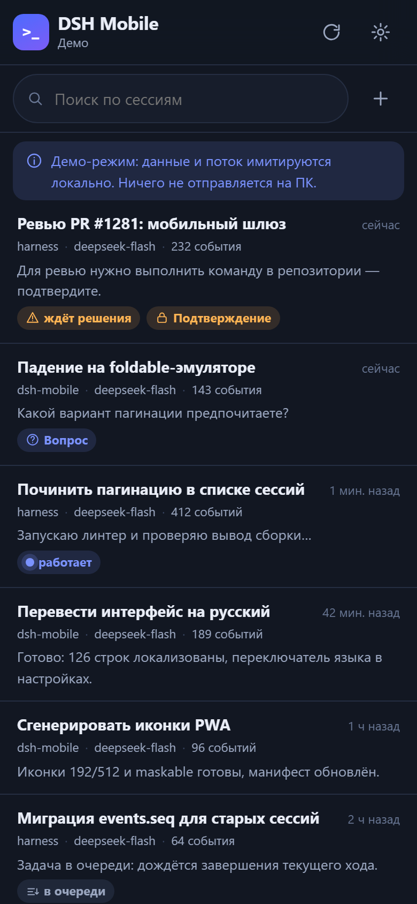 | 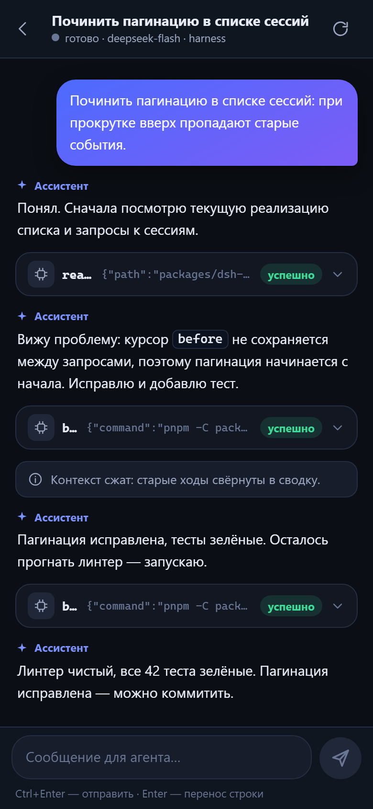 | 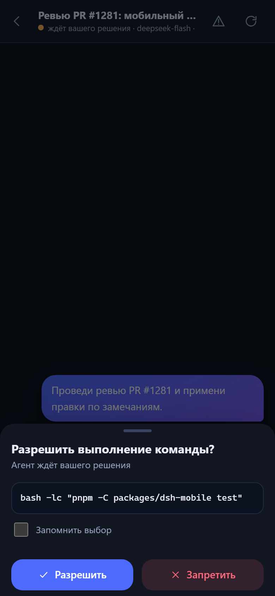 |
| 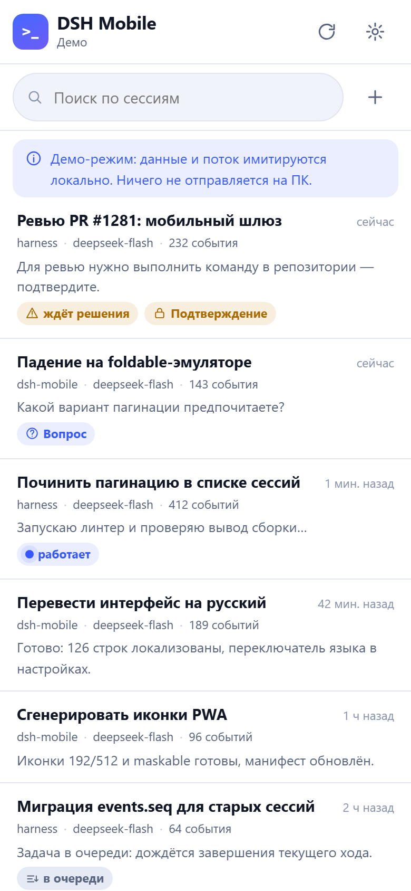 | 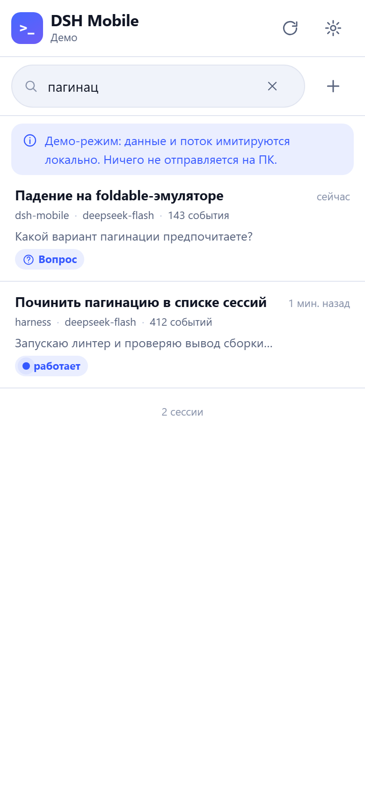 | 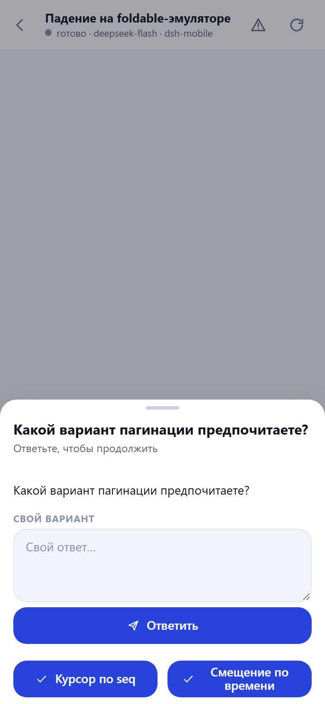 |

Страница привязки на компьютере и раскладной экран:

| Привязка на ПК | Две панели (раскладной/планшет) |
|---|---|
| 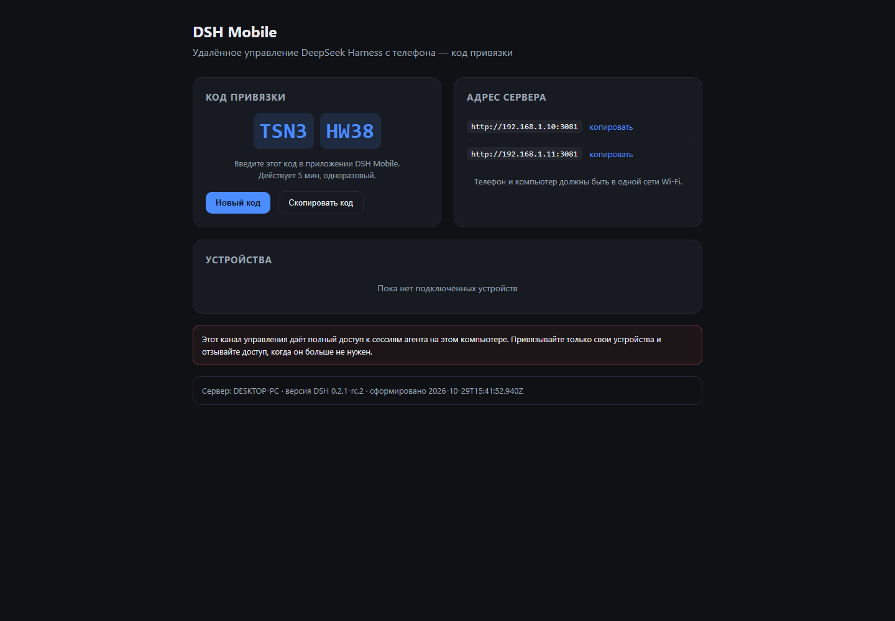 | 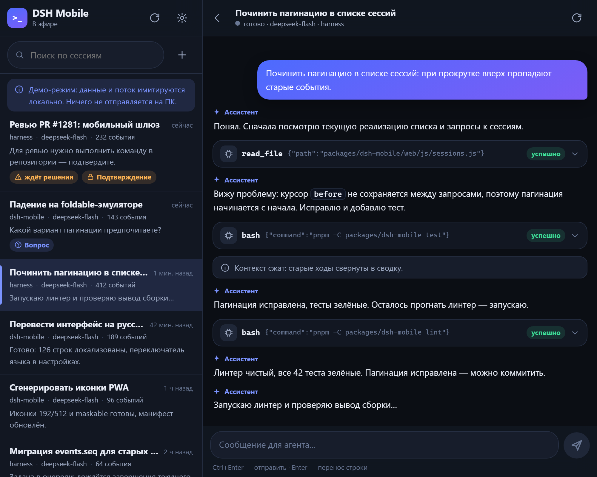 |

Схемы работы:

| Слои установки | Как проходит промпт |
|---|---|
| 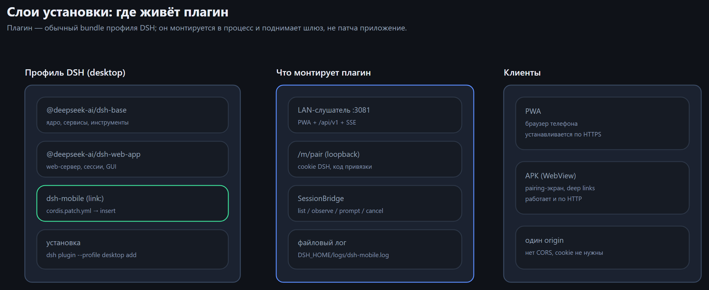 | 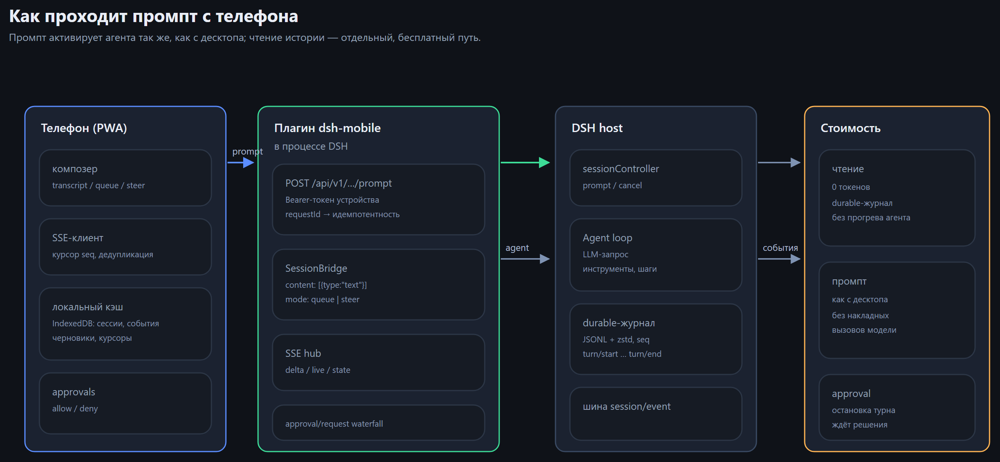 |

| Журнал и события | Границы доверия |
|---|---|
| 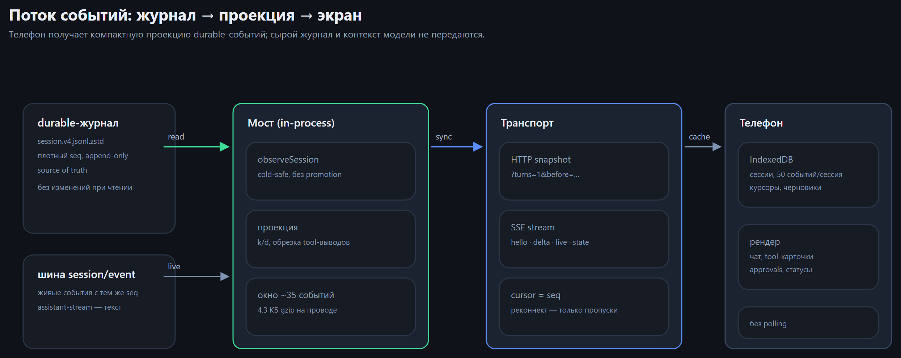 | 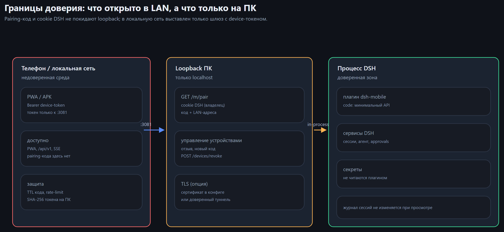 |

| Архитектура | Синхронизация | Approvals |
|---|---|---|
| 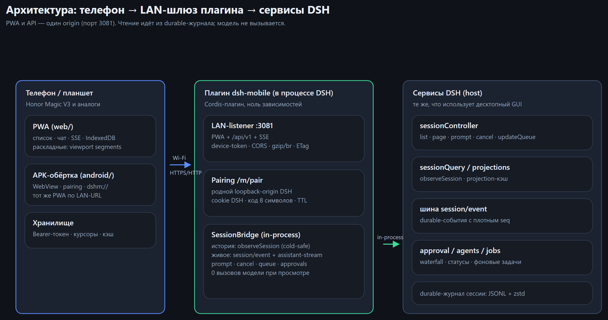 | 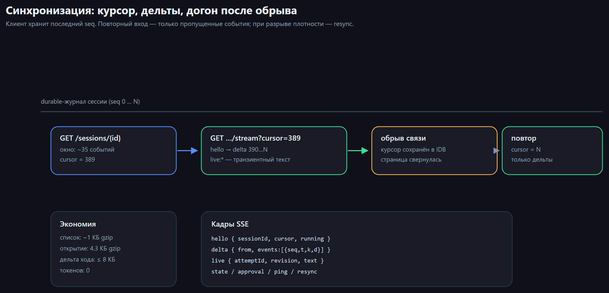 | 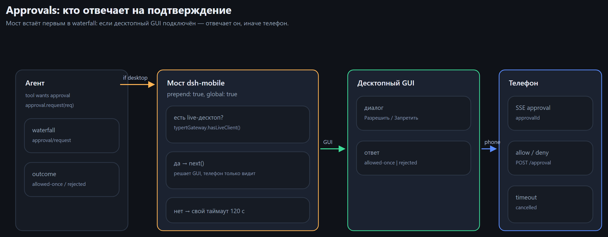 |

Больше иллюстраций — в [PDF-инструкции](docs/guide/DSH-Mobile-Инструкция.pdf) (19 страниц) и [галерее](docs/guide/README.md).

## Структура репозитория

```
packages/dsh-mobile/        плагин + PWA
  lib/index.js              Cordis-вход: LAN-listener, /m/pair, лог-файл
  src/                      конфиг, auth, store, http/static/SSE, routes, session-bridge
  web/                      PWA (vanilla ES modules, без сборки)
  test/                     20 unit/e2e-тестов (node:test, in-process runner)
android/                    Android WebView-обёртка + sync-web.ps1
.github/workflows/android.yml  CI-сборка APK
docs/                       архитектура, установка, протокол, проверки, UX
research/                   исследование API DSH, извлечённый app.asar, тестовый профиль
```

## Документация

- 📄 **[Инструкция с иллюстрациями (PDF, 19 страниц)](docs/guide/DSH-Mobile-Инструкция.pdf)** —
  пошаговое руководство со скриншотами интерфейса и схемами; исходники и скрипты — [docs/guide/](docs/guide/README.md).
- [docs/architecture.md](docs/architecture.md) — архитектура, решения, альтернативы, угрозы.
- [docs/install.md](docs/install.md) — установка, конфиг, обновление, диагностика.
- [docs/mobile-api.md](docs/mobile-api.md) — протокол `/api/v1` (HTTP + SSE).
- [docs/verification.md](docs/verification.md) — как и что проверялось (реальные выводы).
- [docs/ux-notes.md](docs/ux-notes.md) — UX/раскладные/синхронизация.
- [docs/android.md](docs/android.md) — APK/PWA, сборка, ограничения.
- [docs/android-toolchain.md](docs/android-toolchain.md) — установленный локальный тулчейн (JDK 17, SDK 35, Gradle 8.9), сборка и результаты.
- [packages/dsh-mobile/README.md](packages/dsh-mobile/README.md) — пакет плагина.

## Ограничения v1 (честно)

1. **APK собран, но не запускался** локально (нет подключённого устройства/эмулятора);
   сборка Gradle/wrapper проходит, APK проверен `aapt2`.
2. **PWA проверена снимками headless Chromium** (светлая/тёмная темы, раскладной режим);
   интерактивное поведение на физическом телефоне — на устройстве.
3. **Approvals/вопросы вживую не проверены**: нет тестового tool-approval без
   вызова модели; механика waterfall реализована по документации и коду DSH.
4. **Промпты не отправлялись** намеренно (не тратим токены); проверены маршрут,
   валидация, идемпотентность.
5. **Вложения/картинки** не поддерживаются в v1 (`attachments:false`).
6. **Вопросы `ask_user`** — только отображение; ответ на десктопе.
7. HTTP по LAN без TLS — осознанный компромисс для домашней сети.

## Лицензия

MIT (см. `packages/dsh-mobile/package.json`). Проект не является официальным
продуктом DeepSeek; использует публичные API DeepSeek Harness.
